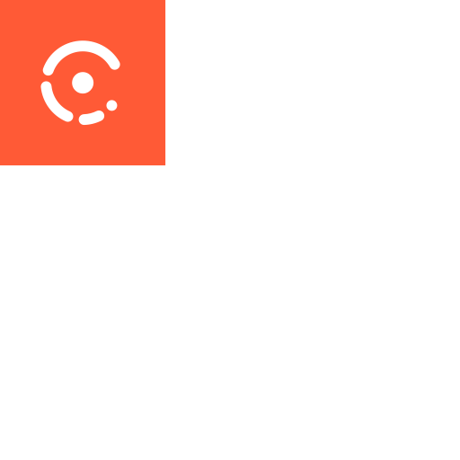
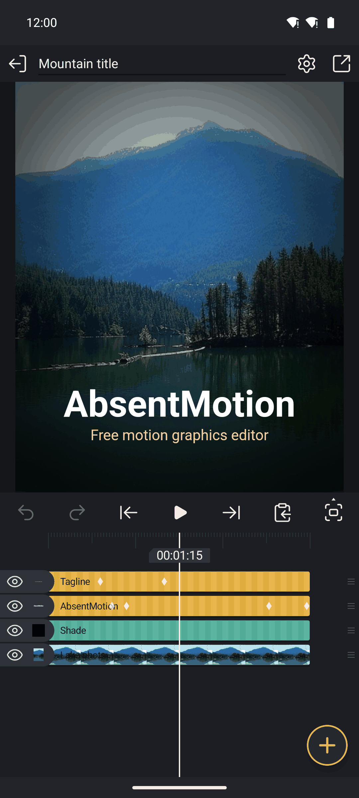
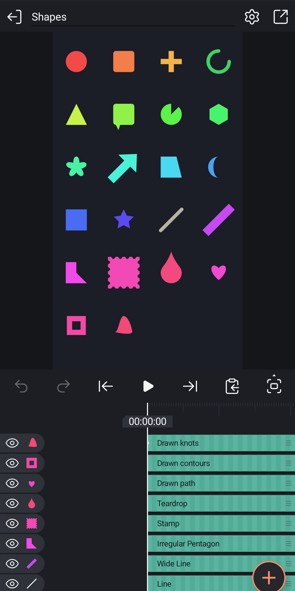

  

# AbsentMotion

  
  
  
  

  
  
  
  
  
  
  

  
   
  Found a bug or have an idea? Come tell us on Discord.

AbsentMotion is a free, open-source alternative to CapCut and Alight Motion: a motion graphics, animation and video
editor for Android phones and Chromebooks, with desktop versions for Mac, Windows and Linux from 5.0. Everything runs on your device and it works without
an internet connection. There is no subscription, no account and no advertising, and your projects never leave your device.

  
  &nbsp;&nbsp;
  

Photo: Ruby Mountain reflected in Diablo Lake, public domain (CC0), Wikimedia Commons.

## What it does

**Faster than Alight Motion:** with the same heavy project on the same phone, AbsentMotion 4.0 started about 5 times faster, opened the project about 3 times faster and exported it in about a quarter less time.

<strong>Layers and a timeline</strong>

Shapes, text, images, video, audio, freehand drawings, groups, reusable elements, 3D models, lights and null objects, with trimming, splitting, moving and stretching several clips at once, parenting, groups you can open and ungroup, clipping masks, label colours, bookmarks, slide-to-select and frame-accurate snapping.

<strong>Keyframes with easing</strong>

Any value (position, size, rotation, 3D tilt, skew, opacity, colour, shape and effect parameters) can be keyframed. Easing is a cubic Bezier, bounce, elastic, cyclic, random or stepped curve, edited with handles on a graph.

<strong>213 effects</strong>

Colour, blur, distort, stylize, noise, keying, Move (Auto-Shake, Oscillate, Swing, Spin, Random Displacement, Random Jitter, Pulse, Echo, Offset, Move Along Path, true motion blur, Parenting Helper, Scale Assist), Repeat (linear, radial, grid, along a path, scatter, with a delay and random variation per copy), 3D objects (cube, sphere, torus, prisms, raster extrude and more), Text (typewriter reveal, per-letter transforms, shaking letters, talking blips, font weight, scramble, count up, timecode), ASCII art, Copy Background (an adjustment layer), VHS, Datamosh, Glass, Displacement Map and many more, with animated previews, presets and a "New" category. [Check out all the effects](https://comett1225.github.io/AbsentMotion/effects/index.html).

<strong>Transitions and animations</strong>

One-tap transitions between clips and In / Out / Loop animations for any layer, written as ordinary keyframes you can edit.

<strong>Shapes and drawing</strong>

Parametric shapes, vector paths with point editing and animated (rotoscoping) masks, SVG import, freehand pen, brush, fill and eraser, borders, shadows, gradients and blend modes. **Colour palettes** in every colour picker: make them from a picture or a palette file (.gpl, .ase, .act, .pal or hex), sort and lock them, and export them as PNG, .gpl or .ase.

<strong>Text</strong>

Text layers with spacing and alignment, 50 fonts built in and 100 more to download from Google Fonts. Letters can shake on their own, type out with a blip for each letter like game dialogue, and change weight with variable fonts.

<strong>Video tools</strong>

Speed ramps with presets and freeze frames, motion tracking, background removal for photos and videos, frame blending and optical-flow slow motion, preview copies for heavy 4K videos, and an in-app camera.

<strong>Camera layers</strong>

A 3D camera that works like Alight Motion's, showing the world around the frame, with perspective or orthographic projection, focus blur, fog, motion blur and one-tap Camera Moves (push in, pull out, orbit, pan, dolly zoom, handheld). Layers in 3D sort by their distance from the camera, the camera tilts and orbits around the scene, and Ambient, Directional and Point lights shade 3D models and 3D effects. With **Sort by piece**, the pieces of 3D Scatter and 3D Fracture, the faces of 3D models and 3D particles sort one by one with other layers, so objects pass through each other. 3D objects turn with your fingers.

<strong>Adobe Animate import</strong>

Open `.fla` files from Flash CS5 and later: shapes, symbols, pictures, classic tweens, masks and sounds become layers and keyframes, and a report lists what came over and what was left out.

<strong>Audio</strong>

Audio layers and the sound of video clips, a waveform view, volume, audio effects (EQ, filters, reverb, echo, compressor, noise gate, limiter, with presets), beat detection (Mark Beats) and noise reduction.

<strong>Offline text to speech and auto captions</strong>

**Offline text to speech** with the voices already on the device, and **auto captions** with on-device speech recognition (whisper.cpp; the speech model is downloaded once, after the app tells you its size).

<strong>Export</strong>

MP4, MOV, MKV or WebM video (H.264, HEVC, AV1, VP9 or APV, as the phone supports), audio settings, audio only (WAV, FLAC, M4A, OGG or MP3), animated GIF, image sequences and single frames, with a time estimate, a storage check, protection when the phone is hot and a check of every finished video and audio file.

<strong>Tools: Compress, Trim, Extract Audio, Make a GIF and Video Downloader</strong>

**Compress** makes videos and pictures smaller (Low, Medium, High, Custom, or a Discord size), shows the size before and after, and lets you watch the result before saving. **Trim** cuts a video fast without re-encoding, or exactly. **Extract Audio** saves the sound of a video as M4A or MP3. **Make a GIF** turns up to 30 seconds of a video into a GIF. **Video Downloader** saves videos, sounds and pictures from links (YouTube, Instagram, TikTok and more) straight to your gallery or into a project.

<strong>Tablets, Chromebooks and computers</strong>

Layouts for big tablet screens in portrait and landscape, with panels beside the preview. Chromebooks run the Android app, with their own files for Intel and AMD chips. From 5.0 there is a desktop version for Macs (Apple silicon and Intel), Windows and Linux (`.deb`, AppImage and `.tar.gz`, arm64 and x86_64): the same editor, effects and export with a mouse timeline, right-click menus, keyboard shortcuts and drag and drop.

<strong>Safe projects</strong>

Automatic version history, crash recovery, crash logs that say in one sentence what happened, imported media copied into the project and one-tap backup of every project to a folder that survives reinstalling.

<strong>25 languages</strong>

English, Indonesian, Hindi, Portuguese (Brazil), Spanish (Latin America), Spanish (Spain), Filipino, Vietnamese, Thai, Malay, Arabic, Persian, Urdu, Turkish, Russian, Bengali, Japanese, Korean, Chinese (Traditional), Chinese (Simplified), French, German, Italian, Polish and Ukrainian, chosen on first start.

## Offline use

AbsentMotion works fully offline and nothing in it depends on the internet. It only goes online for optional things you choose: the font library (you can also add your own fonts), downloading the background removal and captions models, checking for updates, and the Video Downloader.

## Requirements

Android 13 (API level 33) or newer (tested on Android 16 and 17 and on emulators from Android 13), a 64-bit ARM device (`arm64-v8a`), Vulkan 1.1 or OpenGL ES 3.0 (with OpenGL the heaviest AI tools are left out). The Compatible build runs on Android 8 to 12, and its 32-bit file (`armeabi-v7a`) on phones with a 32-bit system from Android 8. Chromebooks with Intel or AMD chips have `x86_64` files of both builds (`-foss-x86_64.apk`, `-compatible-x86_64.apk`, the latter for Android 9 to 12), without the Video Downloader; the in-app update picks the right one.

For Android 8 to 12 there is the **Compatible** build (`-compatible.apk`, tested on Android 11). It is the same app
without Optical flow High, AI Smooth, AI Enhance and AI background removal 2.0.

There are two builds: `foss`, which contains no Google libraries at all, and `compat`, the Compatible build of `foss`
(with a 32-bit file). The `play` build ended with 4.4; Play installs move to `foss` when they update.

Not sure about your phone? The [phone checker](https://comett1225.github.io/AbsentMotion/phone-checker.html) tells you
which build to download.

The desktop version runs on Macs with Apple silicon (`-macos-arm64.dmg`) or an Intel chip (`-macos-x64.dmg`) from macOS 11, on 64-bit Windows 10 and 11 with an Intel or AMD chip (`-windows-x64.msi`), and on Linux (`.deb`, AppImage and `.tar.gz`, `arm64` and `x86_64`) with glibc 2.35 or newer: Ubuntu 22.04, Debian 12 and later.

## Install on a Mac

Download `AbsentMotion-*-macos-arm64.dmg` for a Mac with Apple silicon (M1 or newer) or `AbsentMotion-*-macos-x64.dmg` for
a Mac with an Intel chip, open it and drag AbsentMotion into Applications.

The app is not notarised by Apple, so the first time macOS says it cannot check it. Click **Done**, open **System
Settings** > **Privacy & Security**, scroll down to the message about AbsentMotion, click **Open Anyway** and confirm.
After that it starts like any other app. Updates are offered inside the app.

## Install on Windows

Download `AbsentMotion-*-windows-x64.msi` and open it. If your browser says the file isn't commonly downloaded, choose to
keep it. It installs for your user only, without administrator rights, and adds AbsentMotion to the Start menu and the
desktop. The installer is not signed, so Windows may say it protected your PC: click **More info**, then **Run anyway**. The first start after installing can take a little longer while Windows checks
the new files. Remove it in **Settings** > **Apps**; your projects stay. Updates are offered inside the app.

## Install on Linux

Every release has three Linux files, for `x86_64` and `arm64`. They need glibc 2.35 or newer: Ubuntu 22.04, Debian 12,
Linux Mint 21, Fedora 36 or newer, and current Arch, Manjaro, EndeavourOS and openSUSE Tumbleweed. Pick one:

**AppImage** (any distribution, nothing to install):

    chmod +x AbsentMotion-*-linux-x86_64.AppImage
    ./AbsentMotion-*-linux-x86_64.AppImage

AppImages need FUSE 2. On Ubuntu 22.04 and Debian install it with `sudo apt install libfuse2` (Ubuntu 24.04 and later:
`libfuse2t64`). Without FUSE, start it with `./AbsentMotion-*.AppImage --appimage-extract-and-run`.

**`.deb`** (Ubuntu, Debian, Linux Mint, Pop!_OS, Zorin OS):

    sudo apt install ./AbsentMotion-*-linux-x86_64.deb

It adds AbsentMotion to the app menu. Remove it with `sudo apt remove absentmotion`.

**`.tar.gz`** (Arch, Manjaro, EndeavourOS, Fedora, openSUSE and any other distribution). It installs for your user only,
without root:

    tar -xzf AbsentMotion-*-linux-x86_64.tar.gz
    ./AbsentMotion/install.sh

This copies the app to `~/.local/opt/absentmotion` and adds a menu entry, the icon, the `.absproj` file type and the
command `absentmotion` (in `~/.local/bin`). Remove it with `~/.local/opt/absentmotion/install.sh --uninstall`; your projects
stay. To update, unpack the new version and run its `install.sh` again.

Almost every desktop already has the libraries AbsentMotion needs. If it does not start, install them:

- Arch, Manjaro, EndeavourOS: `sudo pacman -S --needed alsa-lib fontconfig freetype2 libglvnd libx11 libxext libxi libxrender libxtst zlib`
- Fedora: `sudo dnf install alsa-lib fontconfig freetype libglvnd-glx libX11 libXext libXi libXrender libXtst zlib`
- openSUSE: `sudo zypper install libasound2 fontconfig libfreetype6 libGL1 libX11-6 libXext6 libXi6 libXrender1 libXtst6 libz1`
- Debian, Ubuntu, Mint: `sudo apt install libasound2 libfontconfig1 libfreetype6 libgl1 libx11-6 libxext6 libxi6 libxrender1 libxtst6 zlib1g`

Optional, for speed: a Vulkan driver for your graphics card (Mesa's, or NVIDIA's own driver) makes previews and exports
faster; without one AbsentMotion draws on the processor. A VA-API driver (Intel: `intel-media-driver`, AMD: Mesa's VA-API
driver) lets it decode and export video on the graphics card. Sound plays through ALSA, PulseAudio or PipeWire.

On another chip or an older system, build it from source ([`docs/BUILD.md`](docs/BUILD.md), section 9).

**If something goes wrong**

- *The window is blank or grey on Wayland.* AbsentMotion runs through XWayland, which GNOME, KDE Plasma and most Wayland
  desktops start by themselves; install `xwayland` if yours does not. On tiling window managers (sway, Hyprland, i3) the
  menu entry and the `absentmotion` command already set `_JAVA_AWT_WM_NONREPARENTING=1`; set it yourself if you start
  `bin/AbsentMotion` directly.
- *Everything is too small or too big.* AbsentMotion follows `GDK_SCALE` and your desktop's `Xft.dpi` font setting. To pick
  a size yourself: `JAVA_TOOL_OPTIONS=-Dsun.java2d.uiScale=1.5 absentmotion`.
- *Previews are slow, or AbsentMotion says the graphics card could not be used.* Install or update the Vulkan driver
  (`vulkaninfo --summary` shows whether one works). If the graphics driver crashes the app, start it with
  `AM_SOFTWARE_RENDER=1 absentmotion` to draw on the processor.
- *Exports say they use the software encoder.* Install the VA-API driver; `vainfo` should list `VAEntrypointEncSlice`. With
  two graphics cards, choose one with `AM_VAAPI_DEVICE=/dev/dri/renderD129 absentmotion`.
- *Open and save dialogs do not appear.* They use the desktop portal (`xdg-desktop-portal` with the GNOME, KDE or GTK
  part), or `zenity` or `kdialog`. Install one of them.
- *No sound.* Without a sound device, playback is silent; exports still contain the sound.

## Roadmap

[Go here for the full roadmap.](https://comett1225.github.io/AbsentMotion/roadmap.html)

### 5.1

- True frame-by-frame Video Feedback: each copy shows the picture from a moment earlier, so movement leaves trails that swirl into the tunnel, like a camera pointed at its own screen.
- Time Remap: keyframe which moment of a video clip plays at each point, so a clip can speed up, freeze and play backwards inside one layer, for reverse edits. Requested by users.
- During 5.1 and after, there won't be many major patches or features; most updates will focus on stability for the PC versions.

### 6.0

- An IPA file for sideloading on iPhones and iPads.

## Updates to AbsentMotion

There will be weekly updates at minimum, whether it's bug patches, improvement to the engine or new features.

## Limits / Problems

AbsentMotion is a young project. Please know these before you rely on it:

- **Some Alight Motion effects are still missing.** - Please if you're able to, make sure to make an issue for anything that isn't implemented correctly or is broken. If you can't or don't want to use GitHub issues, use the [bug report form](https://forms.gle/6bY8KBPMKc2iUypV6) instead.
- **It's a new project, so it needs lots of feedback.** Tell us what breaks, what is confusing and what is missing: [GitHub issues](https://github.com/Comett1225/AbsentMotion/issues), the [bug report form](https://forms.gle/6bY8KBPMKc2iUypV6) or the [feature request form](https://forms.gle/5ZohVpB2eBPvzhu4A). Check the [roadmap](https://comett1225.github.io/AbsentMotion/roadmap.html) before suggesting something, it might already be planned.

## Why?

Why did I decide to create this when Alight Motion and CapCut already exist? Just in general I see those companies, specifically Alight Motion as very predatory towards their user base. Shoving ads into your face when you open or press any button for an editor is not something that should happen. Especially not an editor as good as Alight Motion. After, comes the subscriptions on both the CapCut side, and the Alight Motion, offering 'amazing features' if you pay a monthly or sometimes weekly fee. What happens when you can't pay any more or forget to pay, or you're unable to restore your subscription? your project is locked and you can't export it with those PREMIUM features. I do understand that only CapCut has some right to making a subscription as a lot of effects send your videos or images to their servers to process from there quicker, though Alight Motion has no excuse for doing this for some basic features, and even screen resolutions. Why spend money, or watch hundreds of ads, or be in pain from not being able to use a feature on those other platforms, when you're able to download an editor for mobile that contains NONE of those things. 

Everything in this app is completely free, you will pay for NOTHING. You will have NO trackers, NO ads, no subscriptions, NO cloud services or anything. I might add a feature to let you add it to your own cloud storage system of your choice in the future, but for now It's kept just like this.

## File compatibility

AbsentMotion can open scene XML files and `.amproj` packages exported from Alight Motion, and it exports scene XML in the same format. Effects that AbsentMotion does not include are kept in the file and are not drawn. AbsentMotion saves its own packages as `.absproj`. It also imports Adobe Animate `.fla` files from Flash CS5 and later. AbsentMotion is an independent project. It is not affiliated with, endorsed by or sponsored by Adobe, Alight Creative, Alight Motion, ByteDance or CapCut. Adobe Animate, Alight Motion and CapCut are trademarks of their owners. [Alight Motion compatibility](docs/ALIGHT_COMPATIBILITY.md) lists every Alight effect and how it comes across.

## Building

The code has one folder per platform: `shared/` (the code every platform runs: the Kotlin and Compose UI, the C++ engine on top
of Skia, effects and texts), `android/` (the phone app, built with Gradle from the root), `pc/` (the desktop app, built with
`cd pc && ./gradlew createDistributable`), and `macos/`, `windows/` and `linux/` for each desktop system. Skia is built from
source. See [`docs/BUILD.md`](docs/BUILD.md).

## Contributing and security

Read [`CONTRIBUTING.md`](CONTRIBUTING.md) before opening a pull request. To report a security problem, see
[`SECURITY.md`](SECURITY.md).

## Credits

Thanks to [TrueMotion](https://github.com/Mushroom65/TrueMotion) by Mushroom65, a project based on AbsentMotion, for feature
ideas, including the Particles effect planned for 4.4.

## Licence

AbsentMotion 5.0 and later is released under the [GNU General Public License v3.0](LICENSE) (GPL-3.0). Version 4.x and
earlier stay under the Apache License 2.0. See [`NOTICE`](NOTICE) and
[`THIRD_PARTY_NOTICES.md`](THIRD_PARTY_NOTICES.md) for the third-party software it uses (Skia, whisper.cpp, RNNoise,
AndroidX Compose and others) and their licences.
