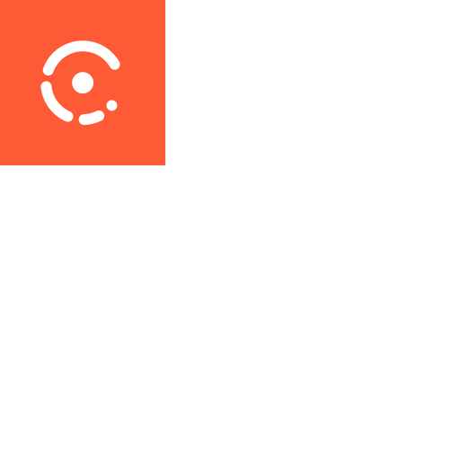
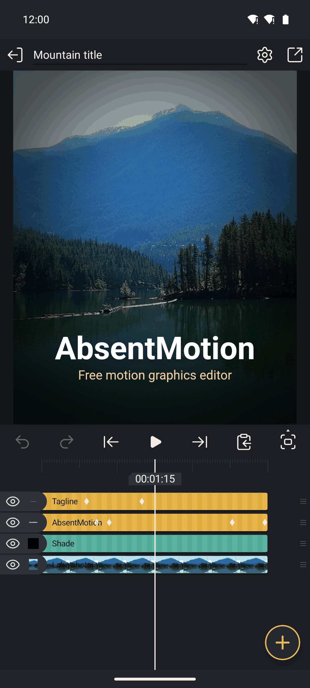
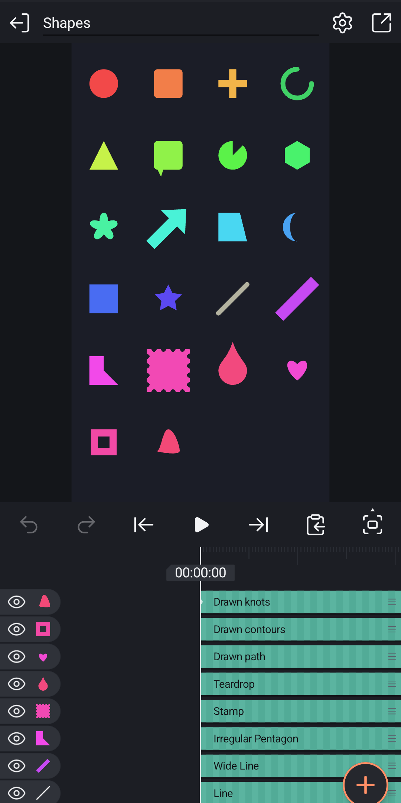

  

# AbsentMotion

  
  
  
  

  
  
  
  
  
  

AbsentMotion is a free, open-source alternative to CapCut and Alight Motion: a motion graphics, animation and video
editor for Android phones. Everything runs on your phone and it works without an internet connection. There is no
subscription, no account and no advertising, and your projects never leave your device.

  
  &nbsp;&nbsp;
  

Photo: Ruby Mountain reflected in Diablo Lake, public domain (CC0), Wikimedia Commons.

## What it does

<strong>Layers and a timeline</strong>

Shapes, text, images, video, audio, freehand drawings, groups, reusable elements, 3D models and null objects, with trimming, splitting, moving clips by holding them, parenting, clipping masks, label colours, bookmarks, slide-to-select and frame-accurate snapping.

<strong>Keyframes with easing</strong>

Any value (position, size, rotation, 3D tilt, skew, opacity, colour, shape and effect parameters) can be keyframed. Easing is a cubic Bezier, bounce, elastic, cyclic, random or stepped curve, edited with handles on a graph.

<strong>184 effects</strong>

Colour, blur, distort, stylize, noise, keying, Move (Auto-Shake, Oscillate, Swing, Spin, Random Displacement, Random Jitter, Pulse, Echo, Offset, Move Along Path, true motion blur), Repeat (linear, radial, grid, along a path, scatter), 3D objects (cube, sphere, torus, prisms, raster extrude and more), Text (typewriter reveal, per-letter transforms, scramble, count up, timecode), VHS, Datamosh, Glass, Displacement Map and many more, with animated previews and a "New" category.

<strong>Transitions and animations</strong>

One-tap transitions between clips and In / Out / Loop animations for any layer, written as ordinary keyframes you can edit.

<strong>Shapes and drawing</strong>

Parametric shapes, vector paths with point editing and animated (rotoscoping) masks, SVG import, freehand pen, brush, fill and eraser, borders, shadows, gradients and blend modes.

<strong>Text</strong>

Text layers with spacing and alignment, 50 fonts built in and 100 more to download from Google Fonts.

<strong>Video tools</strong>

Speed ramps with presets and freeze frames, motion tracking, background removal for photos and videos, frame blending and optical-flow slow motion, preview copies for heavy 4K videos, and an in-app camera.

<strong>Camera layers</strong>

A 3D camera that works like Alight Motion's, showing the world around the frame, with perspective or orthographic projection, depth ordering, focus blur, fog, motion blur and one-tap Camera Moves (push in, pull out, orbit, pan, dolly zoom, handheld). 3D objects turn with your fingers.

<strong>Audio</strong>

Audio layers and the sound of video clips, a waveform view, volume, audio effects (EQ, filters, reverb, echo, compressor, noise gate, limiter, with presets), beat detection (Mark Beats) and noise reduction.

<strong>Offline text to speech and auto captions</strong>

**Offline text to speech** with the voices already on the device, and **auto captions** with on-device speech recognition (whisper.cpp; the speech model is downloaded once, after the app tells you its size).

<strong>Export</strong>

MP4, MOV, MKV or WebM video (H.264, HEVC, AV1, VP9 or APV, as the phone supports), audio settings, audio only (WAV, FLAC, M4A, OGG or MP3), animated GIF, image sequences and single frames, with a time estimate, a storage check, protection when the phone is hot and a check of every finished video and audio file.

<strong>Safe projects</strong>

Automatic version history, crash recovery, crash logs that say in one sentence what happened, imported media copied into the project and one-tap backup of every project to a folder that survives reinstalling.

<strong>14 languages</strong>

English, Indonesian, Hindi, Portuguese (Brazil), Spanish, Filipino, Vietnamese, Thai, Malay, Arabic, Persian, Turkish, Russian and Bengali, chosen on first start.

## Speed

AbsentMotion 4.0 and Alight Motion 5.0.273 on the same phone, a Samsung Galaxy S26 Ultra (Android 17), with the same
heavy project: an edit made in Alight Motion and opened in AbsentMotion from Alight's XML export. It is 13.6 s long,
1080 x 1080 at 60 fps, with two videos cut into 12 clips and 54 effects, among them Motion Blur, Soft Glow, Tiles and
Auto-Shake on every clip. Both apps exported it as H.264 at about 20 Mbps. Median of three runs, timed from screen
recordings; the export runs from tapping Export to the finished file.

| | Alight Motion 5.0.273 | AbsentMotion 4.0 |
|---|---|---|
| Start the app, until the home screen is drawn | 2.20 s | 0.44 s |
| Open the project, until the preview is drawn | 0.86 s | 0.25 s |
| Export the project (816 frames) | 18.3 s | 13.4 s |

### AbsentMotion 3.0 and 4.0

The same phone and project without its effects (3.0 cannot run most of them), both exported at 21 Mbps:

| | AbsentMotion 3.0.0 | AbsentMotion 4.0 |
|---|---|---|
| Start the app, until the home screen is drawn | 0.40 s | 0.39 s |
| Open the project, until the preview is drawn | 0.19 s | 0.17 s |
| Export the project (816 frames) | 3.63 s | 3.53 s |

## Requirements

Android 13 (API level 33) or newer (tested on Android 16 and 17 and on emulators from Android 13), a 64-bit ARM device (`arm64-v8a`), Vulkan 1.1 or OpenGL ES 3.0 (with OpenGL the heaviest AI tools are left out). The Compatible build runs on Android 8 to 12, and its 32-bit file (`armeabi-v7a`) on phones with a 32-bit system from Android 8.

For Android 8 to 12 there is the **Compatible** build (`-compatible.apk`, tested on Android 11). It is the same app
without Optical flow High, AI Smooth, AI Enhance and AI background removal 2.0.

There are three builds: `play`, which has background removal through Google Play services, `foss` (for F-Droid),
which contains no Google libraries at all, and `compat`, the Compatible build of `foss`.

Not sure about your phone? The [phone checker](https://comett1225.github.io/AbsentMotion/phone-checker.html) tells you
which build to download.

## Future Plans ( Roadmap )

The full [roadmap](https://comett1225.github.io/AbsentMotion/roadmap.html) lists what each upcoming version will bring.

**4.4 is the last 4.x version.** If there is an effect or feature you would like, [request it](https://github.com/Comett1225/AbsentMotion/issues/new?template=feature_request.yml) now: from 5.0 on, new features will come more slowly and in smaller numbers than in the 4.x updates.

Possibly a PC version as I love the layout and also simplicity of it. Not sure if chromebooks automatically supported from this being an android app but most likely support will arrive to
- Windows 10/11 (maybe 8/8.1)
- MacOS 15 to 27
- Linux
- Chromebooks
- Possibly releasing IPA versions of this app for iPhones and iPads
This will all be decided later though, for the v5.0 update.

In the future, foss and compatibility will be the only two available for android, as 'play' won't be required in the future.

## Updates to AbsentMotion

There will be weekly updates at minimum, whether it's bug patches, improvement to the engine or new features.

## Limits / Problems

AbsentMotion is a young project. Please know these before you rely on it:

- **Some Alight Motion effects are still missing.** - Please if you're able to, make sure to make an issue for anything that isn't implemented correctly or is broken. If you can't or don't want to use GitHub issues, use the [bug report form](https://forms.gle/6bY8KBPMKc2iUypV6) instead.
- **ARM Android devices only.** Android 13 or newer, or Android 8 to 12 with the Compatible build; phones with a 32-bit system use the Compatible 32-bit build. Phones without
  Vulkan 1.1 draw with OpenGL ES 3.0, which leaves out AI Smooth, AI Enhance, AI background removal 2.0 and Optical flow High.
- **Background removal.** The `foss` build removes backgrounds with its own offline model. The `play` build uses
  Google Play services instead.
- **Network use.** You can completely use this offline, the only other features that would require internet is downloading fonts from the font library (You can upload your own if you have any), downloading the background removal model, captions model and checking for updates, all which are optional and not required for you to use the app.

## Why?

Why did I decide to create this when Alight Motion and CapCut already exist? Just in general I see those companies, specifically Alight Motion as very predatory towards their user base. Shoving ads into your face when you open or press any button for an editor is not something that should happen. Especially not an editor as good as Alight Motion. After, comes the subscriptions on both the CapCut side, and the Alight Motion, offering 'amazing features' if you pay a monthly or sometimes weekly fee. What happens when you can't pay any more or forget to pay, or you're unable to restore your subscription? your project is locked and you can't export it with those PREMIUM features. I do understand that only CapCut has some right to making a subscription as a lot of effects send your videos or images to their servers to process from there quicker, though Alight Motion has no excuse for doing this for some basic features, and even screen resolutions. Why spend money, or watch hundreds of ads, or be in pain from not being able to use a feature on those other platforms, when you're able to download an editor for mobile that contains NONE of those things. 

Everything in this app is completely free, you will pay for NOTHING. You will have NO trackers, NO ads, no subscriptions, NO cloud services or anything. I might add a feature to let you add it to your own cloud storage system of your choice in the future, but for now It's kept just like this.

## File compatibility

AbsentMotion can open scene XML files and `.amproj` packages exported from Alight Motion, and it exports scene XML in the same format. Effects that AbsentMotion does not include are kept in the file and are not drawn. AbsentMotion saves its own packages as `.absproj`. AbsentMotion is an independent project. It is not affiliated with, endorsed by or sponsored by Alight Creative, Alight Motion, ByteDance or CapCut. Alight Motion and CapCut are trademarks of their owners.

## Building

The app is built with Gradle (`app/`) and has a C++ engine on top of Skia, which is built from source. See
[`docs/BUILD.md`](docs/BUILD.md).

## Contributing and security

Read [`CONTRIBUTING.md`](CONTRIBUTING.md) before opening a pull request. To report a security problem, see
[`SECURITY.md`](SECURITY.md).

## Credits

Thanks to [TrueMotion](https://github.com/Mushroom65/TrueMotion) by Mushroom65, a project based on AbsentMotion, for feature
ideas, including the Particles effect planned for 4.4.

## Licence

AbsentMotion is released under the [Apache License 2.0](LICENSE). See [`NOTICE`](NOTICE) and
[`THIRD_PARTY_NOTICES.md`](THIRD_PARTY_NOTICES.md) for the third-party software it uses (Skia, whisper.cpp, RNNoise,
AndroidX Compose and others) and their licences.
