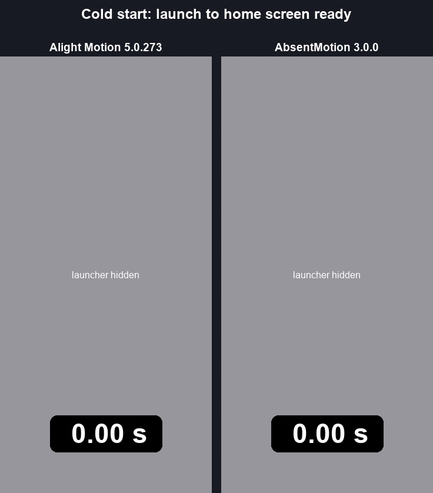

  

# AbsentMotion

  <a href="https://comett1225.github.io/AbsentMotion/"><b>Download for your phone</b></a>
  &nbsp;·&nbsp;
  <a href="https://comett1225.github.io/AbsentMotion/guide.html"><b>Guide and docs</b></a>
  &nbsp;·&nbsp;
  <a href="https://comett1225.github.io/AbsentMotion/phone-checker.html">Will it run on my phone?</a>
  &nbsp;·&nbsp;
  <a href="https://comett1225.github.io/AbsentMotion/effects/index.html">All effects</a>
  &nbsp;·&nbsp;
  <a href="https://github.com/Comett1225/AbsentMotion/releases">All versions</a>

AbsentMotion is a free, open-source alternative to CapCut and Alight Motion: a motion graphics, animation and video
editor for Android phones. Everything runs on your phone and it works without an internet connection. There is no
subscription, no account and no advertising, and your projects never leave your device.

  
  &nbsp;&nbsp;
  

Photo: Ruby Mountain reflected in Diablo Lake, public domain (CC0), Wikimedia Commons.

## What it does

- **Layers and a timeline.** Shapes, text, images, video, audio, freehand drawings, groups, reusable elements, 3D models
  and null objects, with trimming, splitting, moving clips by holding them, parenting, clipping masks, label colours,
  bookmarks, slide-to-select and frame-accurate snapping.
- **Keyframes with easing.** Any value (position, size, rotation, 3D tilt, skew, opacity, colour, shape and effect
  parameters) can be keyframed. Easing is a cubic Bezier, bounce, elastic, cyclic, random or stepped curve, edited
  with handles on a graph.
- **176 effects.** Colour, blur, distort, stylize, noise, keying, Move (Auto-Shake, Oscillate, Swing, Spin, Random
  Displacement, Random Jitter, Pulse, Echo, Offset, Move Along Path, true motion blur), Repeat (linear, radial, grid,
  along a path, scatter), 3D objects (cube, sphere, torus, prisms, raster extrude and more), Text (typewriter reveal,
  per-letter transforms, scramble, count up, timecode), VHS, Datamosh, Glass, Displacement Map and many more, with
  animated previews and a "New" category.
- **Transitions and animations.** One-tap transitions between clips and In / Out / Loop animations for any layer,
  written as ordinary keyframes you can edit.
- **Shapes and drawing.** Parametric shapes, vector paths with point editing and animated (rotoscoping) masks, SVG
  import, freehand pen, brush, fill and eraser, borders, shadows, gradients and blend modes.
- **Text.** Text layers with spacing and alignment, 50 fonts built in and 100 more to download from Google Fonts.
- **Video tools.** Speed ramps with presets and freeze frames, motion tracking, background removal for photos and
  videos, frame blending and optical-flow slow motion, preview copies for heavy 4K videos, and an in-app camera.
- **Camera layers.** A 3D camera that works like Alight Motion's, showing the world around the frame, with perspective or
  orthographic projection, depth ordering, focus blur, fog, motion blur and one-tap Camera Moves (push in, pull out,
  orbit, pan, dolly zoom, handheld). 3D objects turn with your fingers.
- **Audio.** Audio layers and the sound of video clips, a waveform view, volume, audio effects (EQ, filters, reverb,
  echo, compressor, noise gate, limiter, with presets), beat detection (Mark Beats) and noise reduction.
- **Offline text to speech** with the voices already on the device, and **auto captions** with on-device speech
  recognition (whisper.cpp; the speech model is downloaded once, after the app tells you its size).
- **Export.** MP4, MOV, MKV or WebM video (H.264, HEVC, AV1, VP9 or APV, as the phone supports), audio settings, audio only
  (WAV, FLAC, M4A, OGG or MP3), animated GIF, image sequences and single frames, with a time estimate, a storage check,
  protection when the phone is hot and a check of every finished video and audio file.
- **Safe projects.** Automatic version history, crash recovery, crash logs that say in one sentence what happened,
  imported media copied into the project and one-tap backup of every project to a folder that survives reinstalling.
- **12 languages.** English, Indonesian, Hindi, Portuguese (Brazil), Spanish, Filipino, Vietnamese, Thai, Malay,
  Arabic, Turkish and Russian, chosen on first start.

## Speed

  

Measured on a Samsung Galaxy S26 Ultra (Android 17) with the same project in both apps, imported from Alight Motion's
XML export. Median of three runs, phone below 35 °C before each run.

| | Alight Motion 5.0.273 | AbsentMotion 3.0.0 |
|---|---|---|
| Start the app, until the home screen is drawn | 1.94 s | 0.36 s |
| Open a project, until the first preview frame | 0.39 s | 0.27 s |
| Export 4K (2160 x 3840) 30 fps H.264 at the highest quality: video, text, shapes, keyframes | 5.04 s | 4.35 s |
| The same with blur and glow on two layers | 17.28 s | 6.70 s |

Alight Motion draws blur and glow differently (heavier) than AbsentMotion, so the last row is not the same work; the row
above it is the like-for-like export. The GIF shows that run, with the export part at double speed.

## Requirements

Android 13 (API level 33) or newer (tested on Android 16 and 17 and on emulators from Android 13), a 64-bit ARM device (`arm64-v8a`), Vulkan 1.1.

There are two builds: `play`, which has background removal through Google Play services, and `foss` (for
F-Droid), which contains no Google libraries at all.

## Limits

AbsentMotion is a young project. Please know these before you rely on it:

- **Some Alight Motion effects are still missing.** AbsentMotion has 176 effects, and about 17 of Alight Motion's
  are not in it yet. A project that uses one still opens, and the effect stays in the file, but it is not drawn.
- **Only 64-bit ARM Android devices on Android 13 or newer, with Vulkan 1.1.** Tested on Android 16 and 17 and on emulators from Android 13.
- **Background removal.** The `foss` build removes backgrounds with its own offline model. The `play` build uses
  Google Play services instead, a proprietary Google library (listed in `THIRD_PARTY_NOTICES.md`) that downloads its
  model when it is first needed and may send diagnostics to Google under Google's own policy, as it does for any app.
- **Network use.** Nothing is needed online. The internet is only used when you choose one of the downloadable fonts, for
  the speech model the first time you generate captions, and, only if you allow it when asked, to ask GitHub for the
  newest version number when the app opens (the `play` build's Play services library aside, see above).

## File compatibility

AbsentMotion can open scene XML files and `.amproj` packages exported from Alight Motion, and it exports scene XML in the same format. Effects that AbsentMotion does not include are kept in the file and are not drawn. AbsentMotion saves its own packages as `.absproj`. AbsentMotion is an independent project. It is not affiliated with, endorsed by or sponsored by Alight Creative, Alight Motion, ByteDance or CapCut. Alight Motion and CapCut are trademarks of their owners.

## Building

The app is built with Gradle (`app/`) and has a C++ engine on top of Skia, which is built from source. See
[`docs/BUILD.md`](docs/BUILD.md).

## Contributing and security

Read [`CONTRIBUTING.md`](CONTRIBUTING.md) before opening a pull request. To report a security problem, see
[`SECURITY.md`](SECURITY.md).

## Licence

AbsentMotion is released under the [Apache License 2.0](LICENSE). See [`NOTICE`](NOTICE) and
[`THIRD_PARTY_NOTICES.md`](THIRD_PARTY_NOTICES.md) for the third-party software it uses (Skia, whisper.cpp, RNNoise,
AndroidX Compose and others) and their licences.
